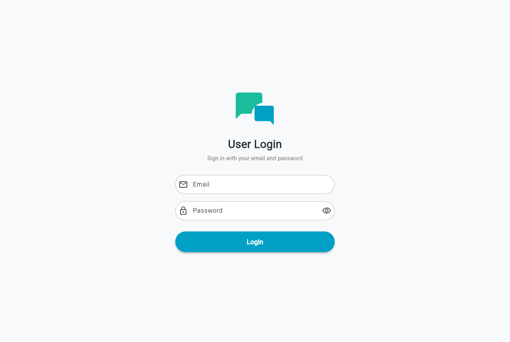
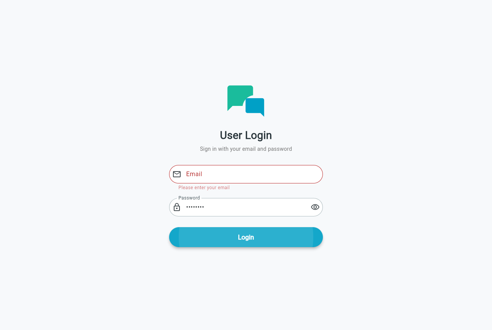
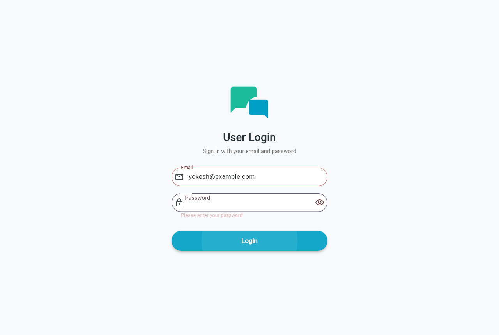
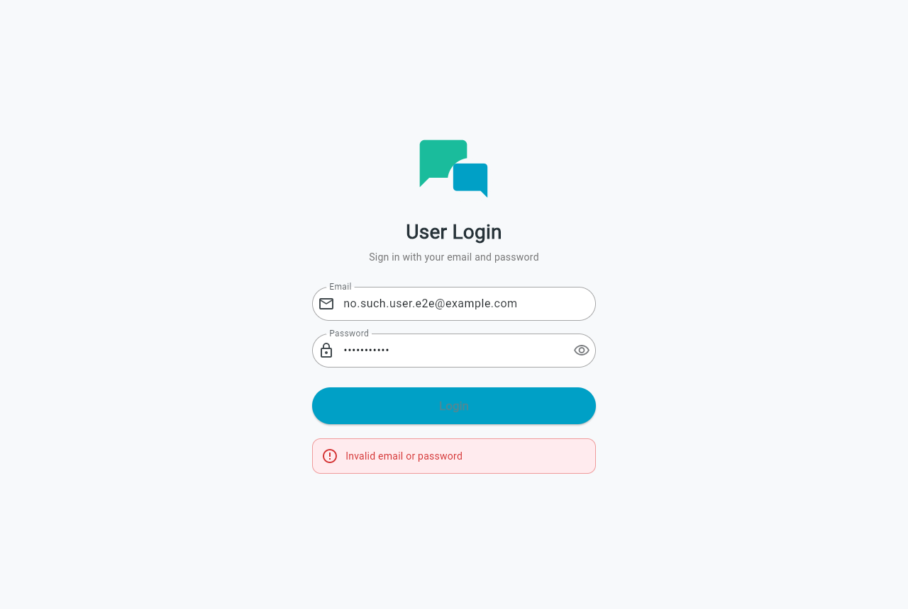
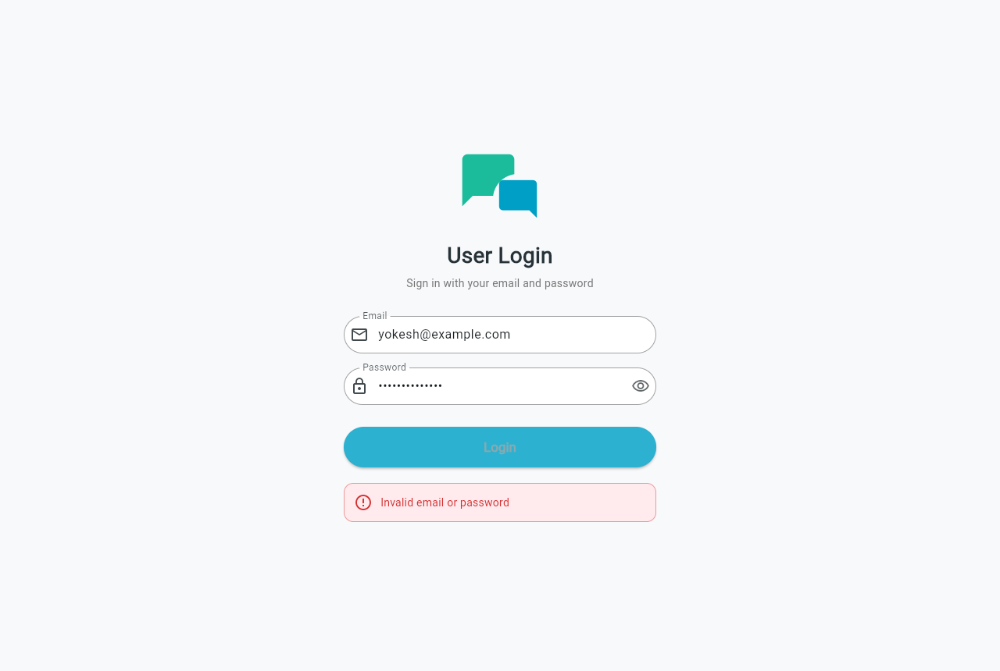
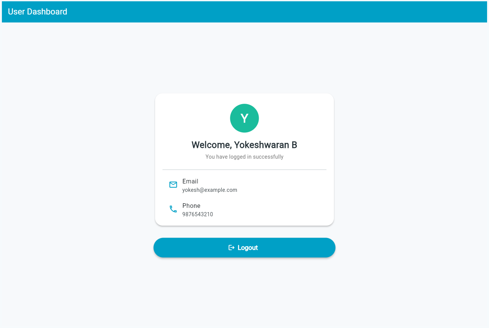
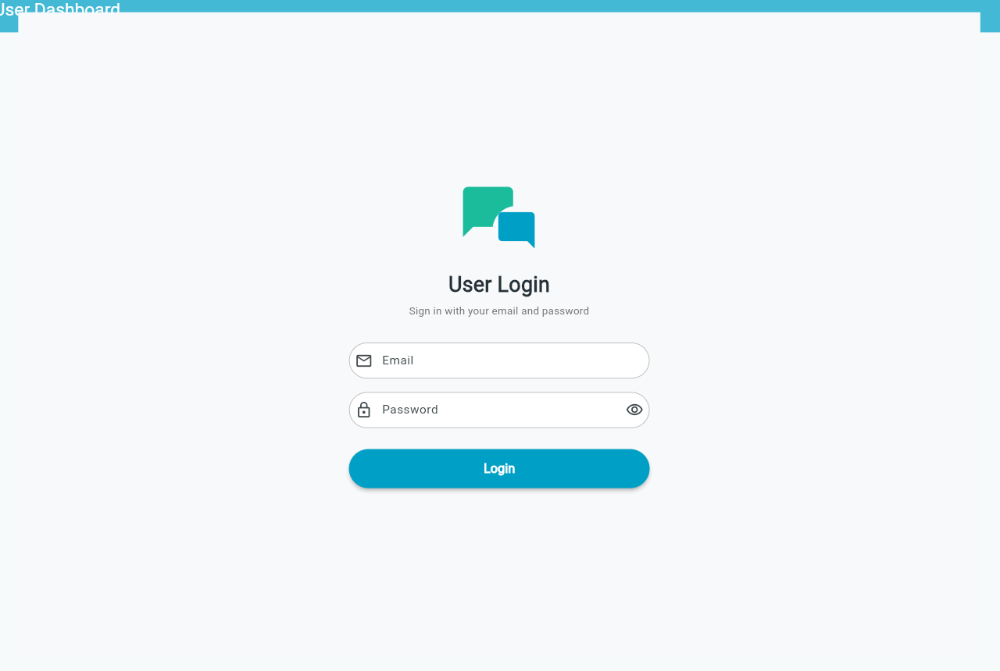
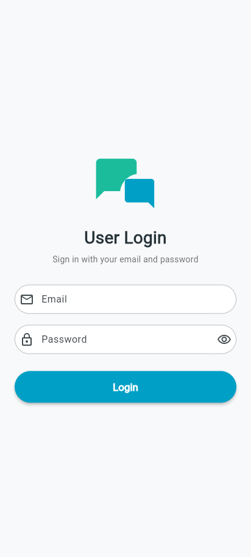
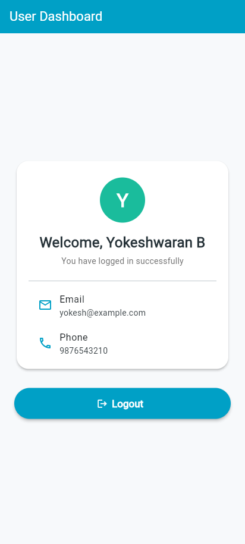

# Experiment 10 – Manual User Login Authentication using Google Firestore

**Manual User Login Authentication using Google Firestore Database (Without Firebase
Authentication)** – URK23CS7070

## Aim

Develop a Flutter application that lets a user log in with an email and password stored
in a Google Firestore `users` collection, verifying the credentials manually in the app
(no Firebase Authentication), with a clean and professional UI.

## Technology Stack

| Layer    | Technology                                  |
|----------|---------------------------------------------|
| Frontend | Flutter (Dart)                              |
| Backend  | Google Cloud Firestore (Firebase)           |
| Hashing  | `crypto` package (SHA-256)                  |
| IDE      | Visual Studio Code                          |
| Platform | Web (Chrome) – Android configured as well   |

Reuses the same Firebase project as Experiments 7–9 (`flutterexperiment7-yb26`).
Firebase Authentication is **not** used – only `firebase_core` and `cloud_firestore`.

## Features

- **User Login** screen styled after the sample: chat-bubble logo, rounded `Email` and
  `Password` fields with icons, show/hide password icon, blue/teal pill **Login** button.
- Validation: empty email, invalid email format, empty password.
- On Login the app queries `users` where `email == <entered email>` (from the server, not
  the cache) and **manually** compares the password in Dart:
  - stored value is a 64-character hex string → compared with `SHA-256(entered password)`
  - otherwise → compared as plain text (also permitted by the exercise)
- Valid → **User Dashboard** with `Welcome, <name>`, email and phone, and a **Logout**
  button that returns to a fresh login screen.
- Invalid email or password → red `Invalid email or password` message.
- Firestore / network errors (and a 15 s timeout) show a message instead of crashing.
- Loading spinner in the Login button; fields and button disabled while checking.
- The stored password / hash is never shown in the UI.
- No signup: the app never writes to Firestore. Users are added in Firebase Console.
- Light background, responsive layout (max width 400 px, scrolls on small screens).

## Firestore Data Model

Collection: `users` (added manually in Firebase Console)

| Field      | Type   | Example                                                            |
|------------|--------|--------------------------------------------------------------------|
| (doc ID)   | Auto ID | `aB3dEf...`                                                       |
| `name`     | string | Abhijith E R                                                        |
| `email`    | string | abhijith@example.com (store in **lowercase**)                        |
| `phone`    | string | 9876543210                                                         |
| `password` | string | SHA-256 hash, e.g. `8776f108e247ab1e2b323042c049c266407c81fbad41bde1e8dfc1bb66fd267e` (= `Test@123`) |

### Adding a user in Firebase Console

1. Open <https://console.firebase.google.com> → project **flutterexperiment7-yb26**
   → **Build → Firestore Database → Data**.
2. Click **+ Start collection** → Collection ID `users` → **Next**
   (if `users` already exists, open it and click **+ Add document**).
3. Document ID: click **Auto-ID**.
4. Add four fields, all of type **string**: `name`, `email`, `phone`, `password`.
5. For `password`, paste the hash printed by
   `dart run tool/hash_password.dart <your password>` (or type the plain password).
6. Click **Save**. Repeat for more users.

## Project Structure

```
lib/
  main.dart               Firebase initialization + app entry
  auth_service.dart       Firestore query + manual email/password check, SHA-256
  login_screen.dart       User Login UI
  dashboard_screen.dart   User Dashboard UI + logout
  firebase_options.dart   (not committed – same config as Experiment 9)
test/
  widget_test.dart        Widget tests with FakeFirebaseFirestore
tool/
  hash_password.dart      Prints SHA-256 hash for the Console password field
  e2e_chrome_test.py      End-to-end test in Chrome against real Firestore
screenshots/              Output screenshots
```

## Run

```bash
flutter pub get
flutter analyze
flutter test
flutter run -d chrome        # or: flutter run (Android emulator / device)
```

End-to-end test (after `flutter build web`, needs Python + Playwright and a user added in
Firebase Console):

```bash
set E2E_EMAIL=abhijith@example.com
set E2E_PASSWORD=Test@123
python tool/e2e_chrome_test.py screenshots
```

## Test Cases

| # | Action                               | Expected output                                  |
|---|--------------------------------------|--------------------------------------------------|
| 1 | Valid email + password, Login        | Dashboard: Welcome, &lt;name&gt;, email, phone   |
| 2 | Valid email + wrong password         | Invalid email or password                        |
| 3 | Unknown email                        | Invalid email or password                        |
| 4 | Empty email                          | Please enter your email                          |
| 5 | Empty password                       | Please enter your password                       |
| 6 | Logout on dashboard                  | Returns to the User Login screen                 |

## Output Screenshots

| Login screen | Empty email | Empty password | Unknown email |
|---|---|---|---|
|  |  |  |  |

| Wrong password | Dashboard | After logout | Mobile login | Mobile dashboard |
|---|---|---|---|---|
|  |  |  |  |  |

## Result

The Flutter application authenticates users manually against the Google Firestore `users`
collection without Firebase Authentication, shows a personalised dashboard on success and
an error message for invalid credentials.

> Note: with the current test-mode Firestore rules, anyone with the project config can
> read the `users` collection. Hashing keeps plain passwords out of the database, but this
> manual approach is for learning only; real apps should use Firebase Authentication.
